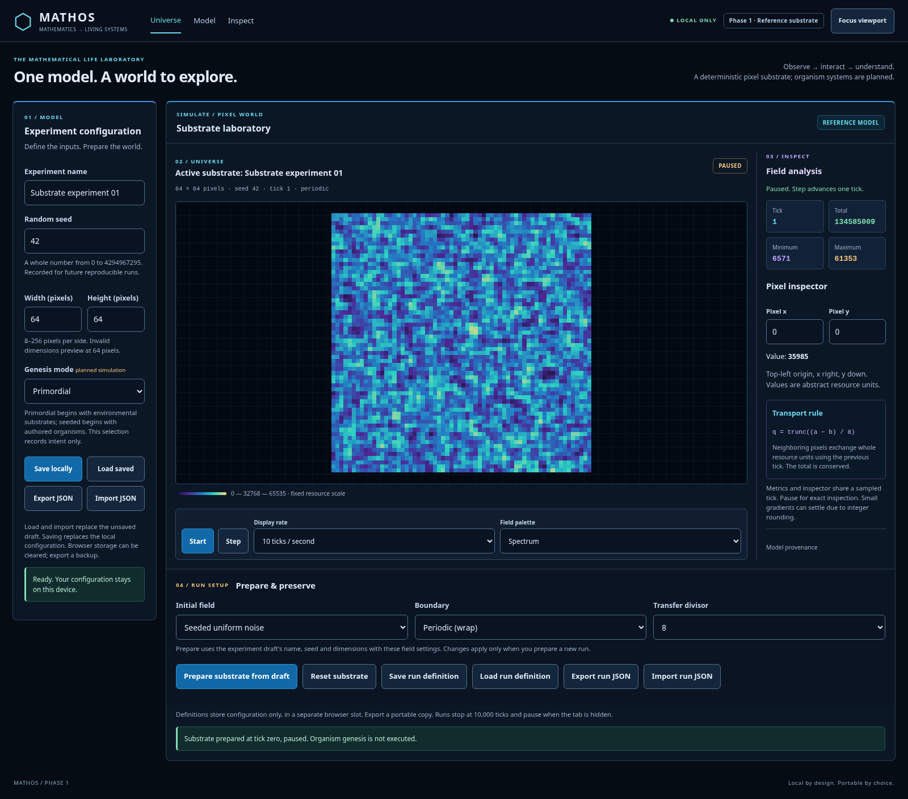
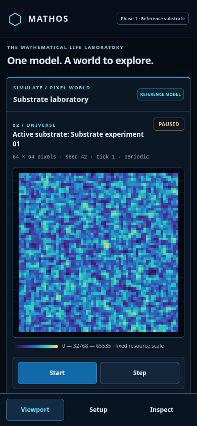
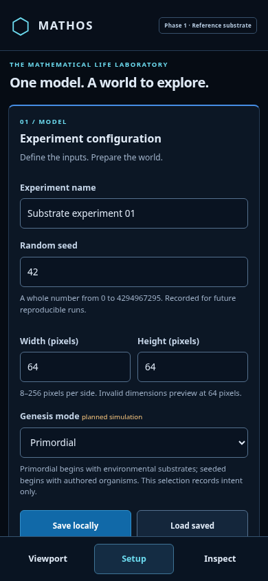
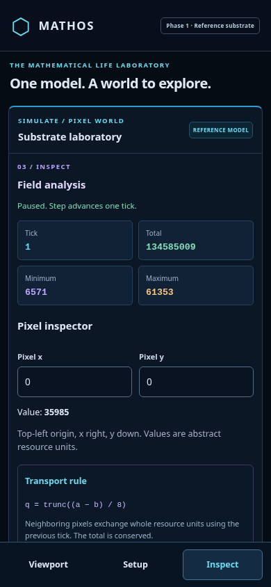

# Dashboard review previews

These are browser captures of the working Phase 1 reference substrate, not generated concept art. State: 64×64, seed 42, uniform noise, periodic boundary, divisor 8, tick 1, paused, Spectrum palette. The original concept is linked and interpreted in [product context](../product-context.md).

## Desktop — 1600px wide

## Phone — 390×844px

| Viewport | Setup | Inspect |
| --- | --- | --- |
|  |  |  |

Phone captures show the actual screen viewport; Setup and Inspect scroll to further controls. View changes preserve the same run. Rate/palette controls are in phone Setup; the phone viewport keeps Start/Step adjacent to the field without covering it.

To reproduce after building: `node scripts/capture-dashboard.mjs`. Screenshots are UI review documentation; scientific experiment output is not committed. These images demonstrate direction and responsive behavior, not completion of the future organism, neural, evolution or mathematical-editor systems.
