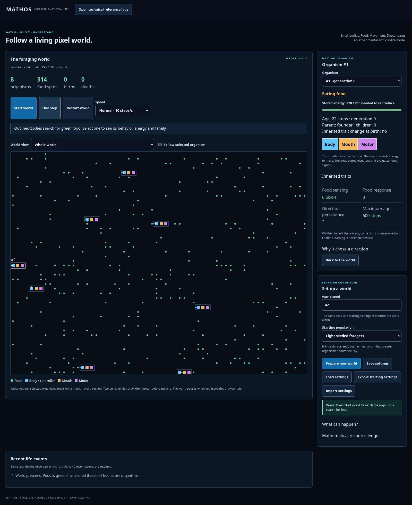
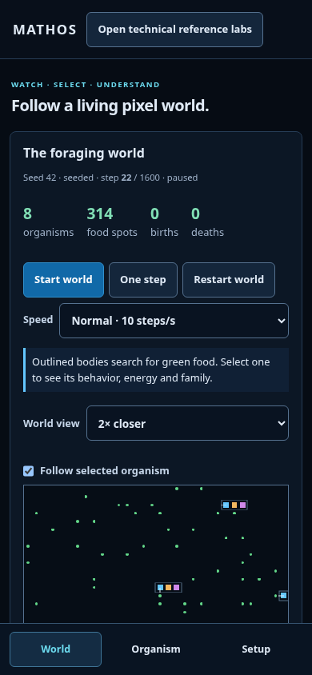
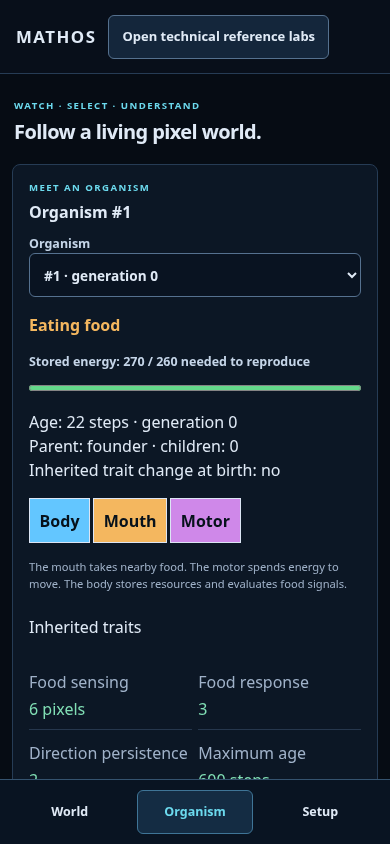
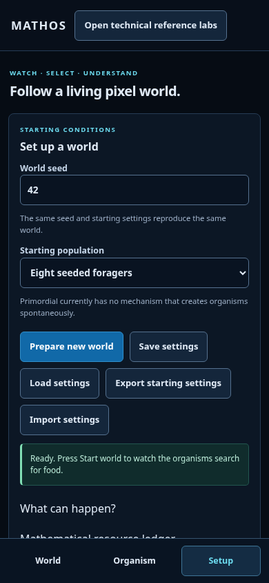

# Observable ecology review

Actual production Chromium captures: ecology-reference@1, seed42, seeded64×48 world, step22, paused. Desktop fits the world; phone uses2× magnification/follow for readable bodies. Camera changes do not change simulation state. These are working simulation screenshots, not concept art.

## Desktop

## Phone —390×844

| World | Organism | Setup |
| --- | --- | --- |
|  |  |  |

Phone panels scroll to further controls. Colored cells have actual functions: blue body/controller, amber mouth, purple motor. Green dots are food. Follow/magnification only affect the view. Mouth intake, motor motion, energy costs, births and deaths are model transitions.

Capture via npm run build then node scripts/browser-ecology.mjs. Temporary outputs under /tmp/mathos-ecology-previews. The play/pause capture step can vary slightly; the displayed step identifies the captured state. These committed images document UI review, not retained experiment datasets.

[Correction plan](../../observable-life-plan.md) · [Model decision](../../decisions/0008-observable-ecology.md) · [Verification](../../observable-life-verification.md)
