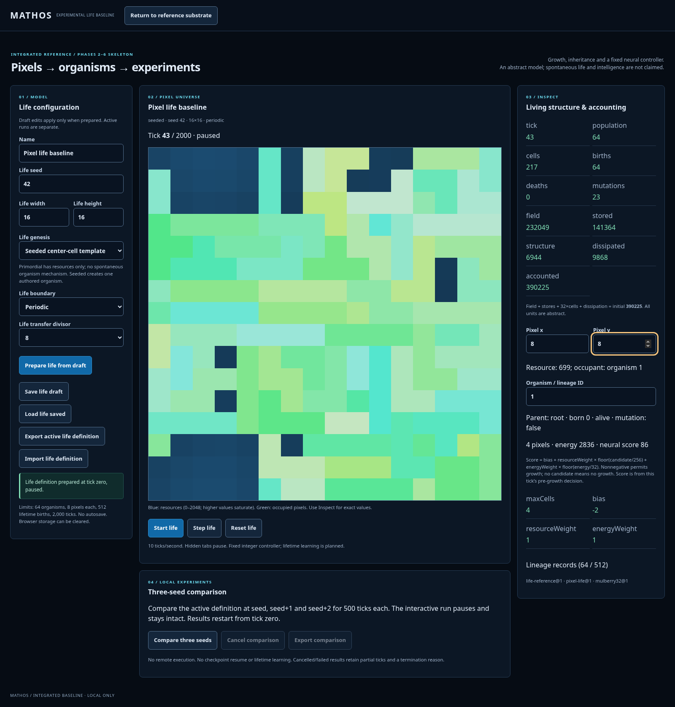
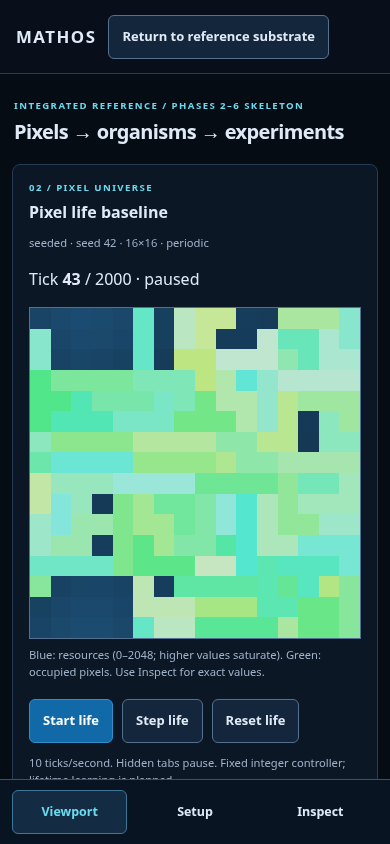
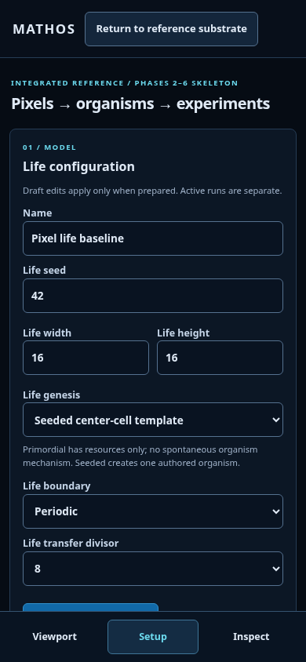
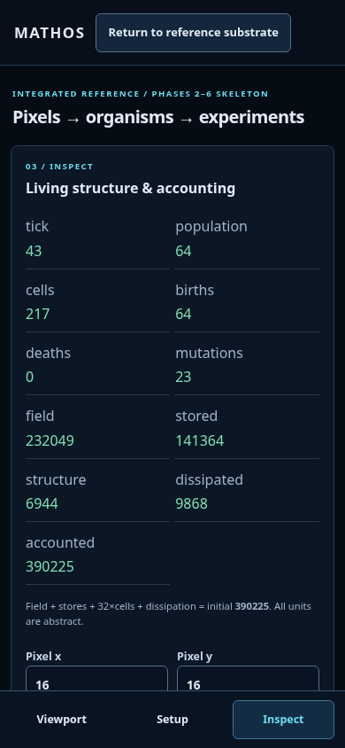

# Integrated life baseline previews

Actual Chromium production-browser captures. Seed 42, 16×16, seeded center-cell template, periodic boundaries, divisor 8, tick 43, paused. All views share the same run. This is an experimental model, not concept art or a claim of biological realism.

## Desktop

## Phone — 390×844

| Viewport | Setup | Inspect |
| --- | --- | --- |
|  |  |  |

Phone views scroll to additional controls/results. The bottom navigation stays reachable and does not change simulation state. Green pixels are actual organism structure; exact values and lineage are available through HTML controls.

Reproduce via `npm run build` then `node scripts/browser-life.mjs`. That workflow starts/pause the run, so its capture tick may vary slightly; the displayed tick identifies the captured state. The independent golden fixtures verify exact deterministic replay. Temporary captures are under /tmp/mathos-life-previews. These committed images are UI review documentation, not retained scientific result datasets.

See [plan](../../integrated-baseline-plan.md), [model](../../decisions/0007-integrated-life-baseline.md) and [verification](../../integrated-baseline-verification.md).
