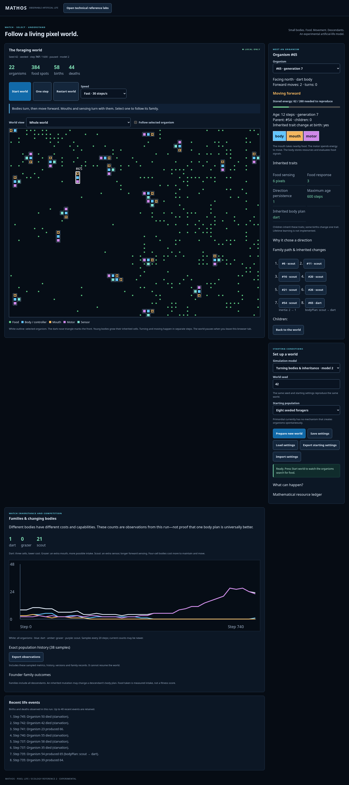
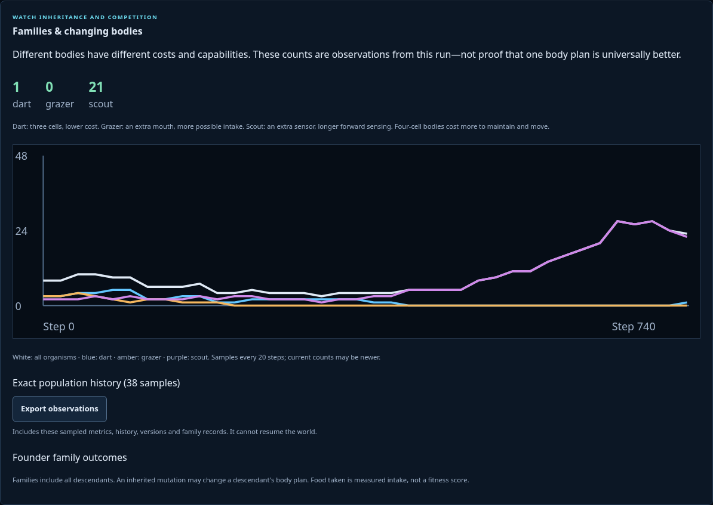
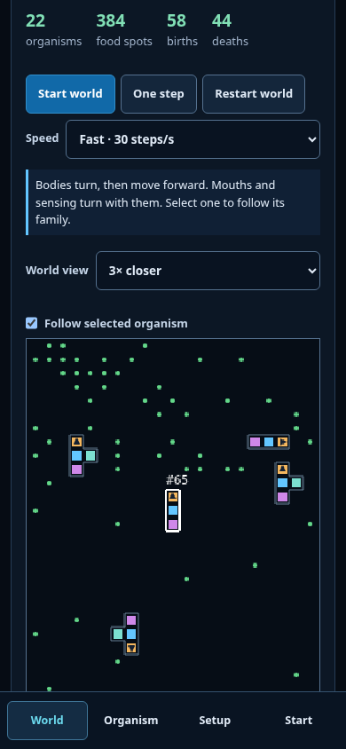
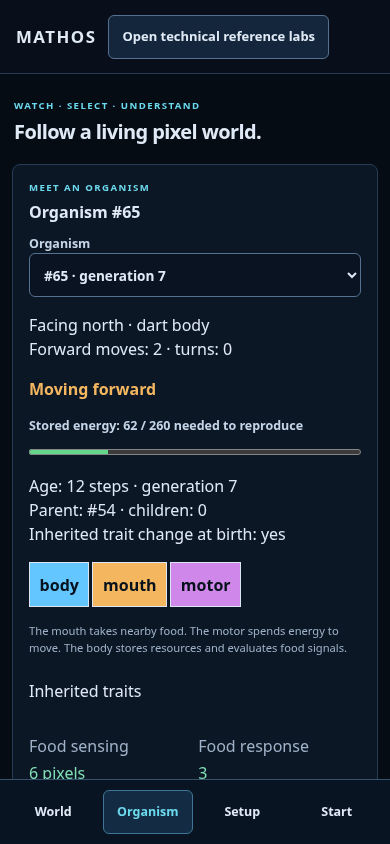
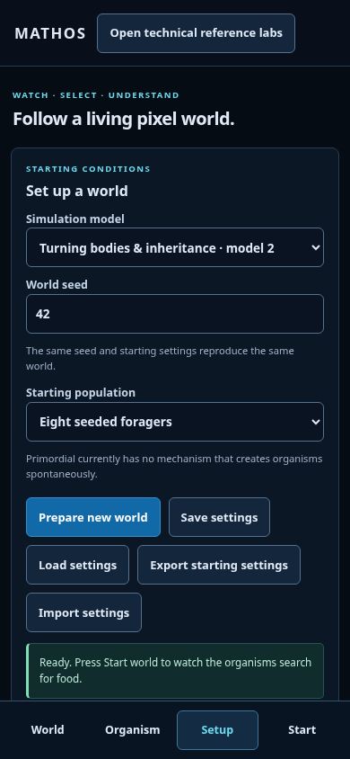

# Turning bodies and inherited variation

Actual production browser captures: model2, seed42, step747, paused. Selected descendant#65 has the inherited mutation **bodyPlan: scout → dart** and has developed its mature body. Earlier ancestors and the exact change are visible in its family path. The three plans are bounded authored encodings, not arbitrary or open-ended organ evolution.

## Desktop

## Measured evolution

## Phone —390×844

| World | Organism | Setup |
| --- | --- | --- |
|  |  |  |

Mouth/motor/sensor/controller locations come from the same geometry as movement, collision, intake and selection. The dark mouth triangle marks the front. Phone uses3× camera follow and focuses the world, with Start/Pause still reachable at the bottom; view settings never change the model. Panels scroll to further history/controls.

Capture: npm run build, then node scripts/capture-turning.mjs. That script first predicts a developed body-plan mutation using the deterministic engine, then runs the actual production UI to that step and selects the descendant. The final captured step can be a little later due to playback sampling. Temporary captures live under /tmp/mathos-turning-previews. These files are UI review documentation, not retained experiment result datasets.

[Plan](../../turning-body-plan.md) · [Exact model](../../decisions/0009-oriented-evolving-bodies.md) · [Verification](../../turning-body-verification.md)
